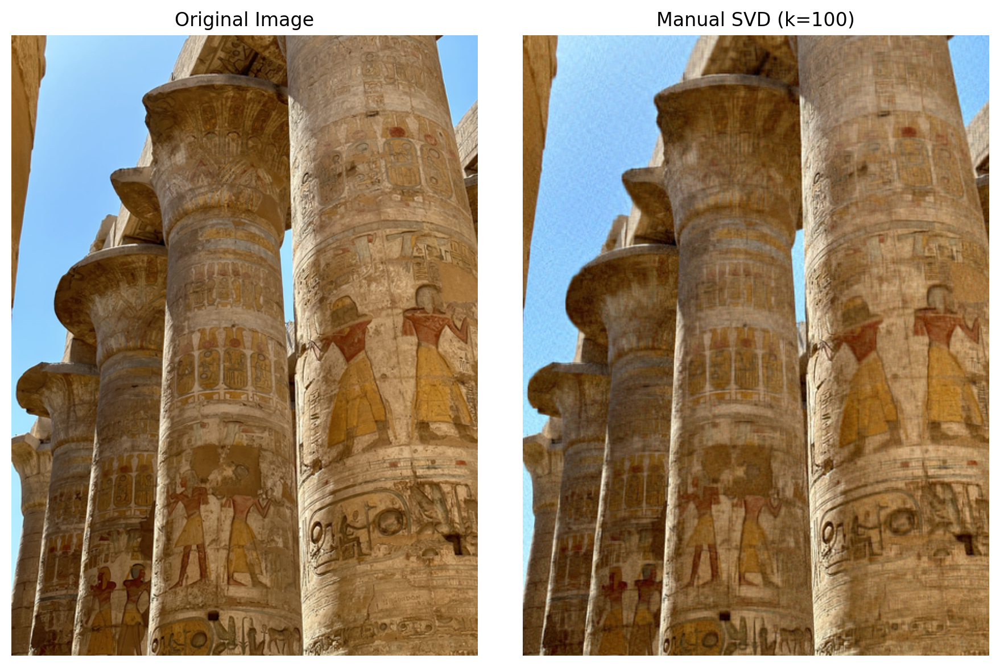

### SVD Implementation from Scratch

  

## Overview

Instead of relying on a library SVD implementation, I implemented **truncated Singular Value Decomposition using power iteration and deflation**.

For each RGB channel:

1. Initialize a random right singular vector.
2. Apply power iteration to approximate the dominant singular vectors.
3. Calculate the corresponding singular value.
4. Subtract the resulting rank-one matrix from the original matrix.
5. Repeat until $k=100$ components have been extracted.

The image is reconstructed using:

$$
A_k=\sum_{i=1}^{k}\sigma_i u_i v_i^T
$$

The resulting low-rank approximation is compared visually with the original image.

**Technologies:** Python, NumPy, Matplotlib.
